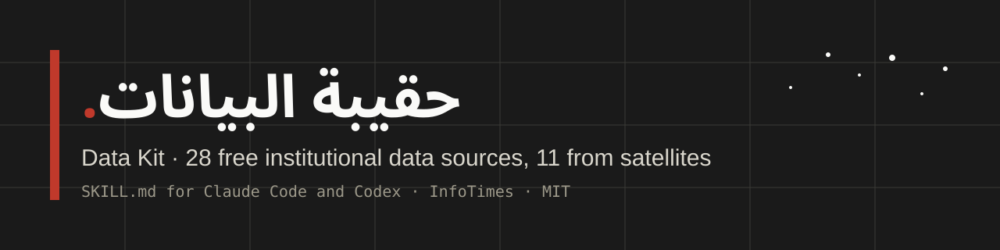

**28 free institutional data sources for Claude Code and Codex, 11 of them from satellites.**

By [Amr Eleraqi](https://github.com/aeleraqi), InfoTimes · One SKILL.md · MIT · Version 0.3.0

[**Download SKILL.md**](https://raw.githubusercontent.com/aeleraqi/data-kit/main/SKILL.md) · [Read the file](SKILL.md) · [See the examples](https://aeleraqi.github.io/data-kit/#examples) · [Browse sources](https://aeleraqi.github.io/data-kit/#sources)

Ask a question the way you'd ask a colleague, in Arabic or English. The skill picks an institutional source, builds the request, fetches the data, and then checks it the way a data editor would: what the indicator measures, which year a number really belongs to, breaks in the series, revisions, units. Every answer ends with an attribution line you can paste into a story and the exact request, so you can run it again next month.

The instructions in `SKILL.md` are written in Arabic. The sources lean towards Egypt, the Gulf, the Levant and North Africa, but most of them cover every country.

## Repeat an analysis

Three examples come with real responses, the calculation and a script you can run without an account or key:

| Question | Example |
| --- | --- |
| Why does Egypt's inflation differ between the World Bank and the IMF? | [Inflation: calendar year vs fiscal year](examples/inflation-fiscal-year/README.md) |
| What share of Egyptians live in extreme poverty now? | [Poverty: a 2025 figure from a 2021 survey](examples/poverty-carried-forward/README.md) |
| Can I show the blackout in Gaza from space? | [Night lights: a map from NASA GIBS](examples/night-lights/README.md) |

Each script fetches live data when you run it and can also run on its saved, dated snapshot with `--offline`. Nothing refreshes in the background. The skill itself doesn't need these scripts or any other file.

## Start with a question

> كم بلغ التضخم في مصر والأردن والمغرب منذ ٢٠٢٠؟
> How has inflation in Egypt, Jordan and Morocco changed since 2020?

The skill goes to the World Bank's consumer-price series. A request on **11 October 2026** returned 18 observations, last updated by the source on 8 October 2026:

| Country | 2020 | 2022 | 2023 | 2024 | 2025 |
| --- | ---: | ---: | ---: | ---: | ---: |
| Egypt | 5.0% | 13.9% | 33.9% | 28.3% | 14.1% |
| Jordan | 0.3% | 4.2% | 2.1% | 1.6% | 1.8% |
| Morocco | 0.7% | 6.7% | 6.1% | 1.0% | 0.7% |

Annual averages, calendar years. The World Bank revises past years, so the answer records the update date next to the numbers. If you ask for a second source, the skill brings in the IMF and flags that Egypt's IMF series runs on fiscal years ([example](examples/inflation-fiscal-year/README.md)).

The [saved response and exact request](data/verified-example.json) are in the repository. In a new conversation the assistant should fetch the data again rather than reuse this table.

Then keep going: "add Tunisia", "show it as a line chart", "give me a CSV".

## Install one file

Save [SKILL.md](https://raw.githubusercontent.com/aeleraqi/data-kit/main/SKILL.md) in your project:

```text
Claude Code  .claude/skills/data-kit/SKILL.md
Codex        .agents/skills/data-kit/SKILL.md
```

Invoke `/data-kit` in Claude Code or `$data-kit` in Codex, followed by your question. [Installation details](docs/INSTALL.md) cover personal install paths and the sources that need keys.

Your session needs a tool that can fetch URLs or make HTTP requests, with network access allowed.

## Sources and current checks

**Economy and society (17):** World Bank, World Bank PIP, IMF DataMapper, WHO, UNHCR, UN SDG, ILOSTAT, HDX, Our World in Data, UN Comtrade, KAPSARC, the Qatar and Bahrain open data portals, NASA POWER, USGS earthquakes, CAPMAS and the ESCWA Arab Development Portal.

**Satellites and Earth observation (11):** Microsoft Planetary Computer, Earth Search, Copernicus Data Space, NASA Black Marble, NASA GIBS, NASA FIRMS, FAO WaPOR, GHSL and WorldPop, JRC Global Surface Water, Copernicus EMS and UNOSAT, and Open-Meteo (ERA5).

The full list, with operator, access route, documentation link and the date each request was last tested, is in [data/catalogue.json](data/catalogue.json).

On **11 October 2026**, most requests returned usable responses. Two were not tested: NASA FIRMS needs a free key, and Open-Meteo was unreachable from the test environment. CAPMAS and the ESCWA portal have no public API and are marked as manual downloads. Copernicus and NASA Earthdata searches are open, but downloading files needs a free account.

Some traps the file teaches, each found while testing:

- The IMF reports Egypt by fiscal year; the World Bank by calendar year.
- Our World in Data fills recent years with older survey values; `original_year` shows it.
- ILOSTAT marks a break in Egypt's youth unemployment series in 2024 (`obs_status = B`).
- A Sentinel-2 scene's cloud cover is for the whole 110 km tile, not your area.
- In WMS 1.3.0 the map box is latitude first; in STAC it's longitude first.

A [paired test](docs/EVALUATION.md) ran 18 fresh answers to three saved-data questions, half without the skill and half with it, graded blind against a fixed rubric. The two arms scored almost the same: 139 and 140 out of 144. The model already caught the three traps on its own; with the skill it stated them more firmly and added more working detail. This small test does not show an accuracy gain, and live retrieval, where the source guides should matter most, wasn't tested. Check dates, coverage and source notes before you publish a number.

## About the project

This file collects the sources I point students and journalists to, and the checks I ask them to run before a number goes into a story, written so an assistant can follow them. It accompanies my data journalism book.

The idea of a single-file data skill comes from Ievgen Kylymnyk's [Global Data Kit](https://github.com/klmnki/public-kit). The text, sources, examples and tests here were written separately. None of the listed institutions endorse the project.

[Send a correction or a tested use case](CONTRIBUTING.md). Instructions and code are [MIT](LICENSE). Provider data keep their own terms; see [NOTICE](NOTICE.md).

## Run the website

Node.js 22 or later. No npm dependencies.

```sh
npm test
npm run build
npm run preview
```

Open `http://127.0.0.1:4188`. The build copies `SKILL.md` into the site unchanged and writes its SHA-256 checksum. Pushing to `main` publishes the site to GitHub Pages.
