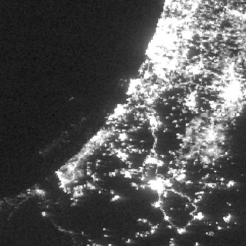
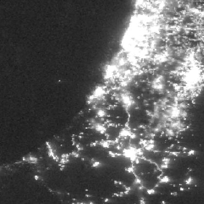

# A map from space

> أريد خريطة تُظهر انقطاع الكهرباء في غزة بعد ٧ أكتوبر ٢٠٢٣.
> I want a map showing the blackout in Gaza after 7 October 2023.

| 15 September 2023 | 13 November 2023 |
| --- | --- |
|  |  |

Gaza is the strip of coast in the lower left. It is lit in September and almost dark five weeks into the war, while the lights to the north and east stay on.

## How the frames were chosen

1. **One source, no account.** NASA GIBS serves ready-made VIIRS night images through a standard map request.
2. **Moonless nights.** The `VIIRS_SNPP_DayNightBand_At_Sensor_Radiance` layer is not corrected for moonlight. A bright moon lights up the ground and hides a blackout. Both dates are new moons; `fetch.mjs --check` computes the illumination and the test fails if either night is more than 5% lit.
3. **Only the date changes.** Same layer, box, size and format. The test checks that the two requests differ only in `TIME`.

**What this can't tell you.** These are display images. They can show that the lights went out; they can't tell you by how much. For a figure like "light fell by X%", use Black Marble (`VNP46A2` daily or `VNP46A3` monthly), which is corrected for moon and cloud, and compare monthly means with the same month a year earlier. One night can also be cloudy, so look at a few.

## Watch the box order

In WMS 1.3.0 with `EPSG:4326`, `BBOX` is **south, west, north, east**: latitude first. STAC catalogues use west, south, east, north. Copy coordinates from one to the other unchanged and you get the wrong place.

## Run it

```sh
node examples/night-lights/fetch.mjs --check   # checks only
node examples/night-lights/fetch.mjs           # downloads both PNGs to downloads/
node --test examples/night-lights/
```

Request (change `TIME` for the other date):

`https://gibs.earthdata.nasa.gov/wms/epsg4326/best/wms.cgi?SERVICE=WMS&REQUEST=GetMap&VERSION=1.3.0&LAYERS=VIIRS_SNPP_DayNightBand_At_Sensor_Radiance&STYLES=&CRS=EPSG:4326&BBOX=30.9,33.9,32.3,35.3&WIDTH=560&HEIGHT=560&FORMAT=image/png&TIME=2023-11-13`

The JPEGs here are greyscale copies of the WMS responses, scaled to 420 px. Imagery: NASA EOSDIS GIBS.
